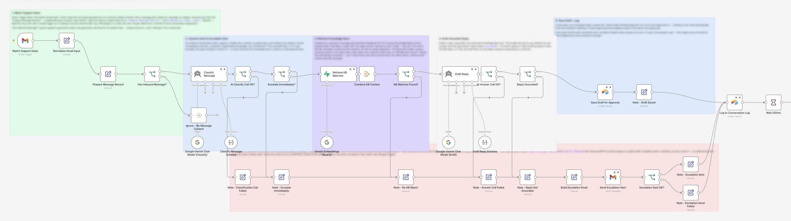
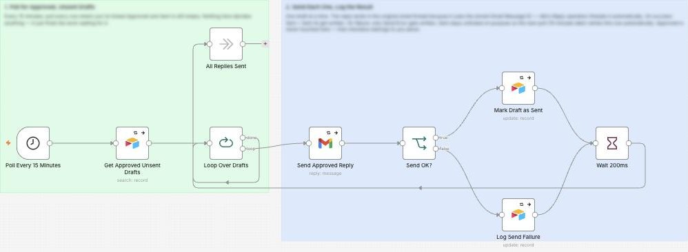

# AI Customer Support Agent

I made an AI that reads customer emails, finds the answer in the business's own FAQs and documents, and writes a reply for the owner to approve.

**For:** Any small business, for example property management and real estate.

**Watch it run:** open the AI Customer Support Agent card in the Gallery on [my portfolio](https://akshita9696.github.io/#gallery). It plays an example run on top of these real workflows.

**Built with:** n8n, Gmail, Gemini, Supabase and Airtable  
**Size:** 4 workflows, 65 steps

## How it works: A question it can answer

1. **A customer emails.** The inbox is checked every minute. The email is tidied into one standard shape and empty ones are dropped. Its own alerts and bounced emails are filtered out, so it can never answer itself in a loop.
2. **AI reads it.** Gemini works out what the customer wants, how urgent it is and whether they sound upset. Then two checks: did the AI call work, and does a person need to step in?
3. **Searches the business's own documents.** The message is matched against the knowledge base in Supabase and the 3 closest entries are combined. No match means a person takes over, never a guess.
4. **AI writes a reply, then checks it.** Gemini drafts a reply using only those documents and has to say whether every word came from them. If the call failed or it guessed anything, a person takes over.
5. **Saved for approval and logged.** The draft waits in Airtable. Nothing is ever sent from this workflow. Every outcome, replied or handed over, gets one row in the conversation log.
6. **The owner approves.** The owner ticks Approved in Airtable. A second workflow checks for approved drafts every 15 minutes, which leaves a window to un-tick a mistake.
7. **Reply sent in the same thread.** Each approved draft goes out as a reply in the customer's original email thread and is marked as sent. If a send fails, the error is logged and it retries on the next check.

## Example: An upset customer

1. **A customer emails.** Same inbox, same one-minute check, same tidy-up.
2. **AI reads it.** Gemini spots a complaint, a request for money and an upset customer. That needs a person, so it skips the AI reply completely.
3. **The owner gets an alert.** An email goes to the owner with the message and the reason it was handed over, so they can call back fast. The workflow even checks that the alert was sent.
4. **Logged.** The hand-over is written to the conversation log, so no message is ever lost.

## Example: No answer in the documents

1. **A customer emails.** Same inbox, same one-minute check, same tidy-up.
2. **AI reads it.** A simple, calm question. Safe to try answering.
3. **Searches the business's own documents.** Nothing in the knowledge base covers it. Instead of making something up, it hands over to a person.
4. **The owner gets an alert.** The owner gets the question with the reason "No matching knowledge base entry found", and the hand-over is logged.

## Workflows in this folder

| File | Workflow | Steps |
| --- | --- | --- |
| [`1-embed-knowledge-base.json`](1-embed-knowledge-base.json) | 1 - Embed Knowledge Base | 16 |
| [`2-support-agent-runtime.json`](2-support-agent-runtime.json) | 2 - Support Agent Runtime | 33 |
| [`3-send-approved-email-replies.json`](3-send-approved-email-replies.json) | 3 - Send Approved Email Replies | 9 |
| [`4-ingest-raw-document-form-upload.json`](4-ingest-raw-document-form-upload.json) | 4 - Ingest Raw Document (Form Upload) | 7 |

## Use it yourself

In n8n, choose **Import from File** and pick a `.json` file. Then attach your own accounts (Gmail, Airtable, Gemini and so on) and replace the placeholders: `you@example.com`, Airtable IDs like `appXXXXXXXXXXXXXX`, and any `YOUR_...` values. No passwords or API keys are included.
