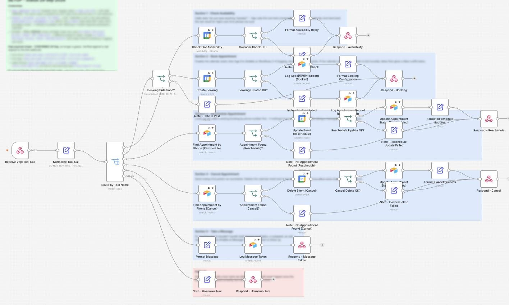
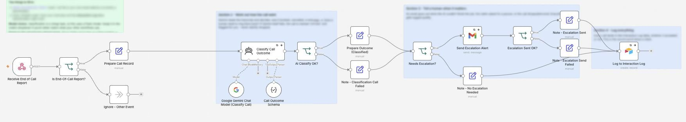
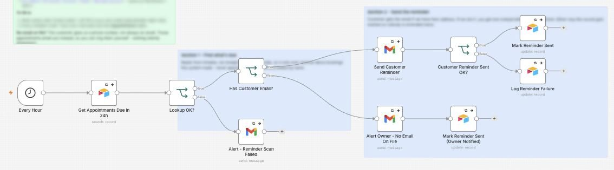

# AI Receptionist

I made a voice AI that answers the phone, books, moves and cancels appointments, takes messages, and emails the owner when a person needs to call back.

**For:** Clinics, salons, trades and any business that misses calls.

**Watch it run:** open the AI Receptionist card in the Gallery on [my portfolio](https://akshita9696.github.io/#gallery). It plays an example run on top of these real workflows.

**Built with:** n8n, Vapi voice AI, Google Calendar, Gemini, Airtable and Gmail  
**Size:** 3 workflows, 68 steps

## How it works: Booking an appointment

1. **A caller asks for an appointment.** The voice AI (Vapi) is on the phone with the caller. When it needs to do something, it calls this workflow, which works out which of its 5 tools was asked for.
2. **Checks the date makes sense.** A booking in the past is caught before anything touches the calendar.
3. **Books it in the calendar.** It creates the Google Calendar event, then logs the appointment in Airtable so the reminders know it exists. If the calendar write fails, the caller is told honestly instead of getting a false confirmation.
4. **The call ends and Gemini reads it.** When the call ends, Vapi sends the full transcript. Gemini decides how it went: booked, cancelled, a message, or someone needs to ring back. If Gemini fails, the call is marked Unclear and flagged, never dropped.
5. **Nobody needs to call back, so it is logged quietly.** Every call lands in the interaction log, whether it needed a person or not. That log is the record you would show a client.
6. **A reminder the day before.** Every hour it looks for bookings in the next 24 hours that haven't been reminded yet. It reads from Airtable, so it only reminds people about bookings this system made.
7. **Reminder sent, never twice.** The customer gets the reminder by email and the booking is marked, so nobody is reminded twice. Email for now; text messages slot in when a paying client needs them.

## Example: A caller who needs a person

1. **A caller asks for something the AI should not handle.** Same phone line, same routing to the right tool.
2. **Takes a message.** Anything the AI should not handle itself, like a complaint or a pricing question, is logged in Airtable as a message for a person to follow up.
3. **The call ends and Gemini reads it.** Gemini reads the transcript and sees the caller asked for a person.
4. **The owner gets an email.** An email goes out when the AI could not finish the job, the caller asked for a person, or the call dropped. The call is logged either way.

## Example: Moving an appointment

1. **A caller wants to move their booking.** Same phone line, same routing to the right tool.
2. **Finds the booking by phone number.** It looks up the caller's booking by their phone number first. If nothing is found, the AI offers to take a message instead of guessing.
3. **Moves it.** It updates the calendar, marks the Airtable record Rescheduled and tells the caller.

## Workflows in this folder

| File | Workflow | Steps |
| --- | --- | --- |
| [`1-voice-agent-tool-backend.json`](1-voice-agent-tool-backend.json) | 1 - Voice Agent Tool Backend | 40 |
| [`2-end-of-call-logging-and-escalation.json`](2-end-of-call-logging-and-escalation.json) | 2 - End of Call Logging and Escalation | 17 |
| [`3-appointment-reminder-scan.json`](3-appointment-reminder-scan.json) | 3 - Appointment Reminder Scan | 11 |

## Use it yourself

In n8n, choose **Import from File** and pick a `.json` file. Then attach your own accounts (Gmail, Airtable, Gemini and so on) and replace the placeholders: `you@example.com`, Airtable IDs like `appXXXXXXXXXXXXXX`, and any `YOUR_...` values. No passwords or API keys are included.
