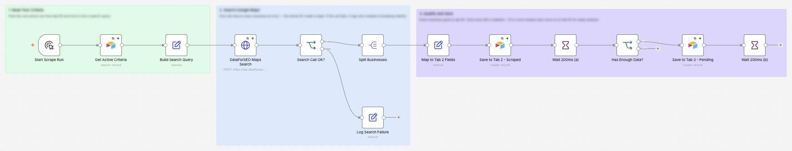
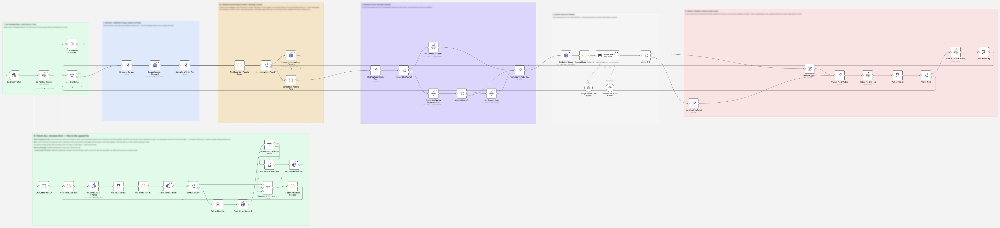
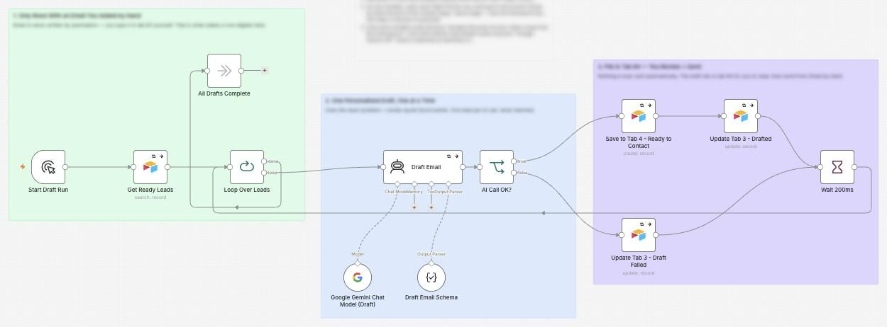

# Lead Intelligence System

I made a system that finds local businesses on Google Maps, checks their website, reviews and YouTube, picks out their biggest problem, ranks them, and drafts a personal outreach email.

**For:** Agencies, real estate, aesthetics clinics and dentists looking for new clients.

**Watch it run:** open the Lead Intelligence System card in the Gallery on [my portfolio](https://akshita9696.github.io/#gallery). It plays an example run on top of these real workflows.

**Built with:** n8n, DataForSEO, Firecrawl, the YouTube API, Gemini and Airtable  
**Size:** 3 workflows, 71 steps

## How it works

1. **Reads the search.** It pulls the active search from Airtable and turns it into a Google Maps query.
2. **Searches Google Maps.** One call returns every business at once. If it fails, it logs why instead of breaking silently.
3. **Qualifies and saves.** Every business is saved. Only the ones with a website and 10 or more reviews move on to deep analysis.
4. **Fetches all the reviews at once.** The speed fix: every review job is posted up front in batches of 100 and the workflow waits once, instead of 45 seconds per business. 10 leads or 1,000, same wait.
5. **Reads the website.** Firecrawl reads the homepage, plus the contact or booking page if there is one, because that's where the real details usually are.
6. **Checks their YouTube and digital footprint.** It finds the business's own channel, from the website first because that's free, and when it last posted. Plain code then counts facts like booking type, forms and live chat, so the AI gets the same answer every run.
7. **Gemini finds the problem.** One business per AI call, never batched, because mixing businesses breaks accuracy. Then it scores priority from how strong the problem is and how complete the data is.
8. **The owner adds the email, the AI drafts.** Email addresses are never scraped: the owner types them in by hand. Gemini then writes one personal draft using the exact problem and a real review quote. It waits in Airtable for the owner to read and send from Gmail.

## Workflows in this folder

| File | Workflow | Steps |
| --- | --- | --- |
| [`1-scrape-and-qualify.json`](1-scrape-and-qualify.json) | 1 - Scrape and Qualify | 13 |
| [`2-deep-analysis-and-priority.json`](2-deep-analysis-and-priority.json) | 2 - Deep Analysis and Priority | 46 |
| [`3-contact-and-draft.json`](3-contact-and-draft.json) | 3 - Contact and Draft | 12 |

## Use it yourself

In n8n, choose **Import from File** and pick a `.json` file. Then attach your own accounts (Gmail, Airtable, Gemini and so on) and replace the placeholders: `you@example.com`, Airtable IDs like `appXXXXXXXXXXXXXX`, and any `YOUR_...` values. No passwords or API keys are included.
