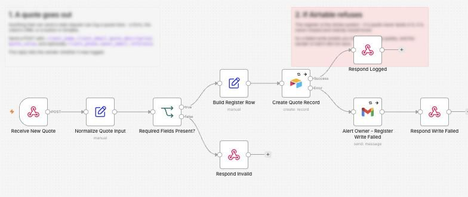
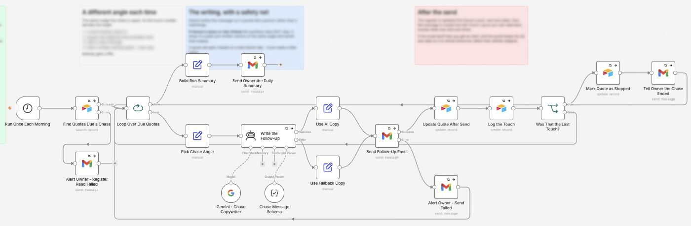
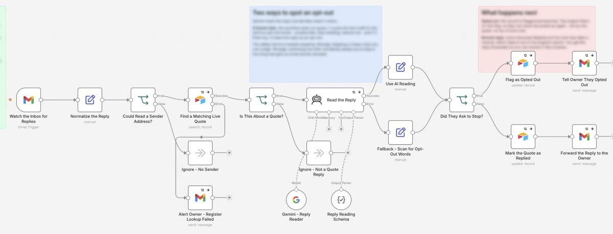

# Quote Follow-Up

I made an automation that chases every quote with up to 4 different messages, and stops as soon as the client replies or opts out.

**For:** Trades and service businesses losing jobs to unanswered quotes.

**Watch it run:** open the Quote Follow-Up card in the Gallery on [my portfolio](https://akshita9696.github.io/#gallery). It plays an example run on top of these real workflows.

**Built with:** n8n, Airtable, Gemini and Gmail  
**Size:** 3 workflows, 46 steps

## How it works: Chasing a quote

1. **A quote goes out.** Anything that can send a web request, like a form, a CRM or an Airtable button, logs the quote. It lands in the quote register and the sender is told it was saved. If Airtable refuses, the owner is emailed instead of it failing quietly.
2. **Every morning, it finds quotes due a nudge.** Once a day it asks Airtable which quotes are due a chase. Quotes that were replied to, won, lost or opted out are filtered out before anything is written.
3. **A different angle each time.** The touch number picks the angle: a friendly check-in, the likely objection, an offer to talk, then a smaller starting option. Gemini writes it so it sounds like a person. If Gemini is down, a plain pre-written version goes instead.
4. **Sent and logged.** The register gets the new touch count and next date, and the message is copied into the touch log. If the email fails, the owner is alerted and it retries tomorrow.
5. **The owner gets a daily summary.** When every due quote has been chased, the owner gets one summary email. After the fourth touch a quote is marked Stopped and nobody gets a fifth.

## Example: The client replies

1. **The client writes back.** It watches the inbox. When an email arrives, it checks whether the sender has a live quote. This is the stop switch: nobody gets chased after they reply.
2. **Gemini reads the reply.** Gemini decides what the reply means. If Gemini fails, it scans for opt-out words itself and errs towards stopping.
3. **The chase stops and the owner hears about it.** The quote is marked Replied, which takes it out of the chase, and the reply is forwarded so the owner can answer it like a human.

## Example: The client asks to stop

1. **The client writes back.** Same inbox watch, same check for a live quote.
2. **Gemini reads the reply.** Gemini sees an opt-out.
3. **Flagged for good.** The record is flagged permanently, so they can never be chased again, not for this quote or a future one. The owner is told.

## Workflows in this folder

| File | Workflow | Steps |
| --- | --- | --- |
| [`1-log-new-quote.json`](1-log-new-quote.json) | 1 - Log New Quote | 9 |
| [`2-chase-due-quotes.json`](2-chase-due-quotes.json) | 2 - Chase Due Quotes | 19 |
| [`3-reply-and-outcome-handler.json`](3-reply-and-outcome-handler.json) | 3 - Reply and Outcome Handler | 18 |

## Use it yourself

In n8n, choose **Import from File** and pick a `.json` file. Then attach your own accounts (Gmail, Airtable, Gemini and so on) and replace the placeholders: `you@example.com`, Airtable IDs like `appXXXXXXXXXXXXXX`, and any `YOUR_...` values. No passwords or API keys are included.
