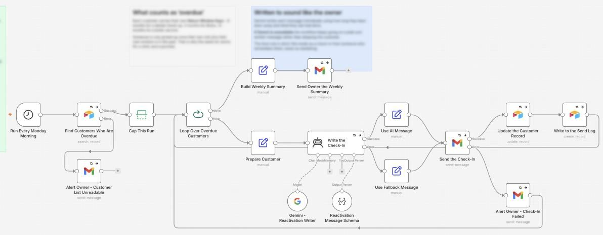
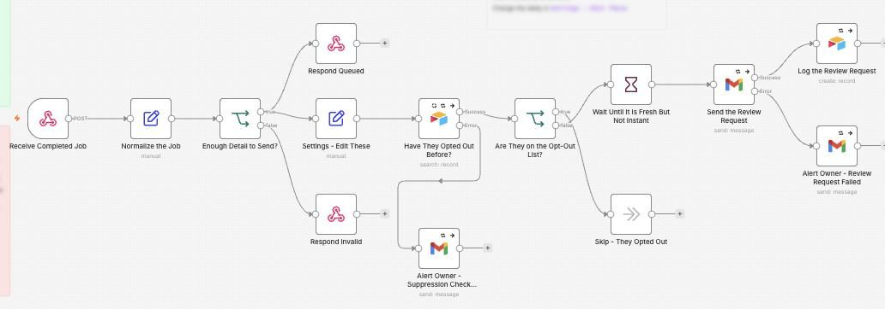
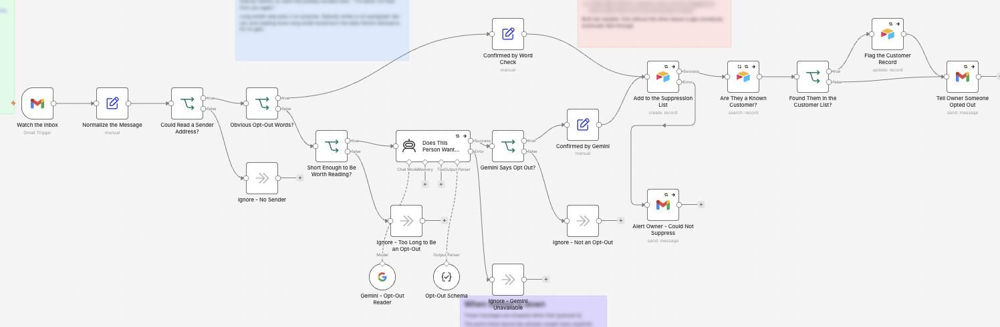

# Reactivation and Reviews

I made an automation that brings back customers who are overdue a visit, asks every customer for a review after a job, and respects anyone who opts out.

**For:** Dentists, salons and home services that rely on repeat customers.

**Watch it run:** open the Reactivation and Reviews card in the Gallery on [my portfolio](https://akshita9696.github.io/#gallery). It plays an example run on top of these real workflows.

**Built with:** n8n, Airtable, Gemini and Gmail  
**Size:** 3 workflows, 52 steps

## How it works: Bringing back a quiet customer

1. **Every Monday, it finds who's overdue.** Each customer has their own return window: 6 months for a dental check-up, 3 for Botox, 12 for a boiler service. Opted-out customers are filtered out first, and one run sends 25 messages at most.
2. **Written to sound like the owner.** Gemini writes each message using how long they've been away and what they last had done. It reads as a check-in from someone who remembers them, never as marketing. If Gemini is down, a plain message goes instead.
3. **Sent, recorded, summarised.** The customer record is updated so nobody is contacted twice inside 90 days, or more than twice ever. The owner gets a weekly summary.

## Example: Asking for a review

1. **A job is marked complete.** The business's own system sends the finished job here.
2. **Checks the opt-out list.** Anyone who has asked to be left alone is skipped.
3. **Waits, then asks everyone the same way.** A couple of hours later, while it's still fresh, the customer gets one short email. Everyone gets the same email and the same private way to reply to a person. Nobody is screened first, because Google bans review gating.

## Example: Someone asks to be left alone

1. **An email arrives.** Pass one is a free word check for the obvious ones: unsubscribe, remove me, stop emailing. Short, politely worded emails go to Gemini as a second pass.
2. **Suppressed everywhere.** The address goes on the suppression list, which every review request checks, and their customer record is flagged, which takes them out of the reactivation sweep. Both, so nobody falls through a gap.

## Workflows in this folder

| File | Workflow | Steps |
| --- | --- | --- |
| [`1-dormant-customer-sweep.json`](1-dormant-customer-sweep.json) | 1 - Dormant Customer Sweep | 17 |
| [`2-review-request-after-job.json`](2-review-request-after-job.json) | 2 - Review Request After Job | 14 |
| [`3-opt-out-and-suppression.json`](3-opt-out-and-suppression.json) | 3 - Opt-Out and Suppression | 21 |

## Use it yourself

In n8n, choose **Import from File** and pick a `.json` file. Then attach your own accounts (Gmail, Airtable, Gemini and so on) and replace the placeholders: `you@example.com`, Airtable IDs like `appXXXXXXXXXXXXXX`, and any `YOUR_...` values. No passwords or API keys are included.
