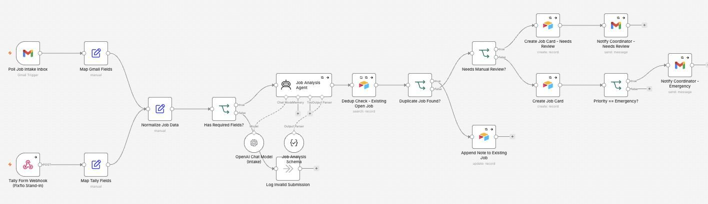
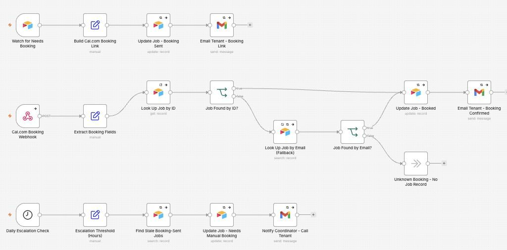
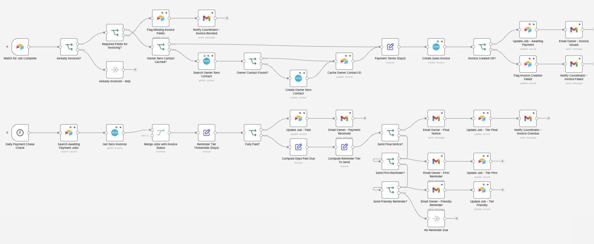
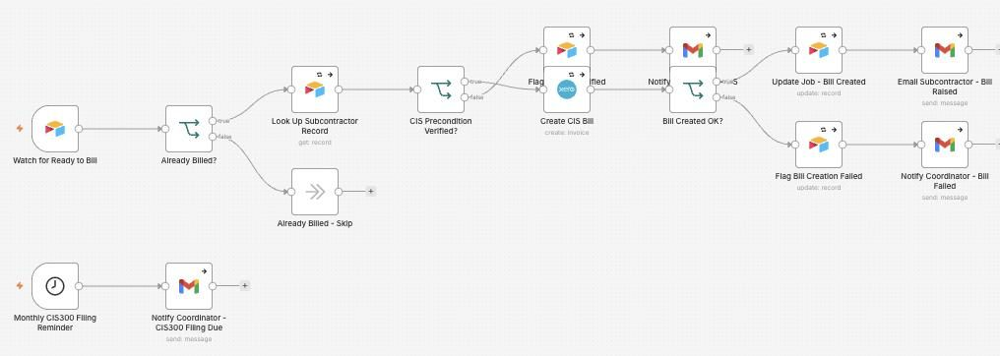
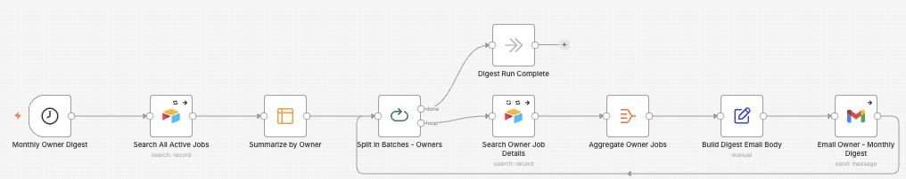

# Property Management Automation

I made a set of automations for booking, job intake, invoicing, subcontractor tax (CIS) through Xero, and a monthly summary for each property owner.

**For:** Letting agents and property maintenance companies.

**Watch it run:** open the Property Management Automation card in the Gallery on [my portfolio](https://akshita9696.github.io/#gallery). It plays an example run on top of these real workflows.

**Built with:** n8n, Airtable, OpenAI, Cal.com, Xero and Gmail  
**Size:** 5 workflows, 100 steps

## How it works

1. **A tenant reports a repair.** Repairs come in by email or by a form standing in for Fixflo. Both are tidied into one shape and checked for the details a job needs.
2. **AI reads the job.** OpenAI reads the report. A repeat report is added to the job that already exists instead of making a new one. Unclear jobs go to the coordinator for review, and emergencies are flagged straight away.
3. **The tenant picks a time.** The tenant is emailed a Cal.com link to book the visit.
4. **Booking confirmed.** When they book, the job is matched by its ID, or by email as a fallback, and marked Booked. If nobody books in time, a daily check tells the coordinator to call the tenant.
5. **Job done, invoice raised in Xero.** When the job is marked complete, it checks it hasn't been invoiced already, finds or creates the owner in Xero, raises the invoice and emails the owner.
6. **Chases payment, politely first.** Every day it checks Xero. An unpaid invoice gets a friendly reminder, then a firm one, then a final notice, and the coordinator is told when one is overdue.
7. **Pays the subcontractor, CIS checked.** Before a subcontractor's bill is raised in Xero, it checks their CIS (Construction Industry Scheme) status is verified. If it isn't, the coordinator is told instead. A monthly reminder flags the CIS300 return.
8. **The monthly owner digest.** Once a month, every property owner gets one email summarising their jobs.

## Workflows in this folder

| File | Workflow | Steps |
| --- | --- | --- |
| [`job-intake.json`](job-intake.json) | PM Template - Job Intake | 19 |
| [`booking.json`](booking.json) | PM Template - Booking | 18 |
| [`invoicing.json`](invoicing.json) | PM Template - Invoicing | 39 |
| [`subcontractor-cis.json`](subcontractor-cis.json) | PM Template - Subcontractor CIS | 15 |
| [`owner-digest.json`](owner-digest.json) | PM Template - Owner Digest | 9 |

## Use it yourself

In n8n, choose **Import from File** and pick a `.json` file. Then attach your own accounts (Gmail, Airtable, Gemini and so on) and replace the placeholders: `you@example.com`, Airtable IDs like `appXXXXXXXXXXXXXX`, and any `YOUR_...` values. No passwords or API keys are included.
