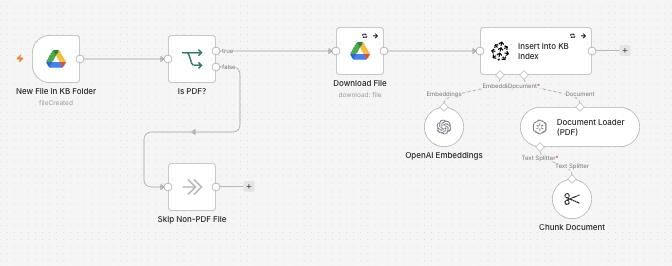
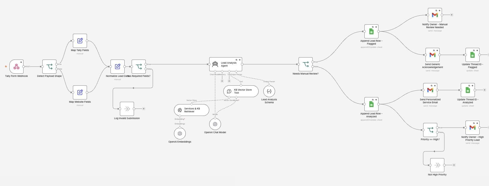
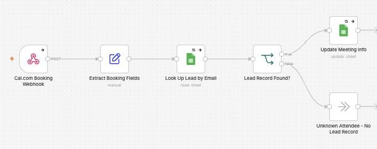
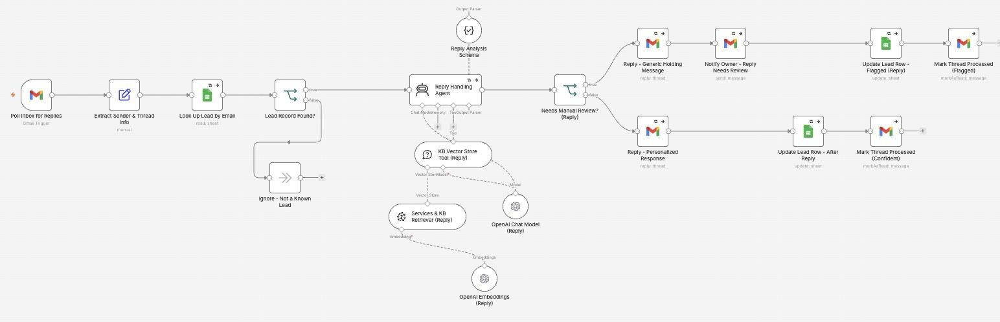

# AI Automation Agency Backend

I made the system behind my own automation business: it takes in leads from my form, syncs meetings, and replies to emails using my own knowledge base.

**For:** Running my own business.

**Watch it run:** open the AI Automation Agency Backend card in the Gallery on [my portfolio](https://akshita9696.github.io/#gallery). It plays an example run on top of these real workflows.

**Built with:** n8n, Tally, OpenAI, Pinecone, Google Sheets, Cal.com and Gmail  
**Size:** 4 workflows, 57 steps

## How it works: A new lead

1. **A lead fills in my form.** Leads come from my Tally form or my website. Both are tidied into one shape and checked.
2. **AI reads it against my services.** OpenAI reads the enquiry and looks up my own services and knowledge base in Pinecone to work out what would help. Anything unclear is flagged for me.
3. **A personal reply goes out.** The lead is saved to Google Sheets and gets a personal email about the services that fit. High-priority leads ping me too.
4. **They book a call.** When they book on Cal.com, the meeting is added to their lead record.
5. **They reply by email.** Replies from known leads are answered using the same knowledge base. If the AI isn't confident, the lead gets a holding message and I get a heads-up instead.

## Example: Teaching it something new

1. **A new document joins the knowledge base.** Dropping a PDF into a Google Drive folder adds it to the knowledge base: it's split into chunks, embedded with OpenAI and stored in Pinecone, ready for the next lead.

## Workflows in this folder

| File | Workflow | Steps |
| --- | --- | --- |
| [`kb-ingestion-pinecone.json`](kb-ingestion-pinecone.json) | KB Ingestion - Pinecone (Agency) | 8 |
| [`tally-lead-intake.json`](tally-lead-intake.json) | Tally Lead Intake (Agency) | 24 |
| [`cal-com-meeting-sync.json`](cal-com-meeting-sync.json) | Cal.com Meeting Sync (Agency) | 6 |
| [`gmail-reply-handling.json`](gmail-reply-handling.json) | Gmail Reply Handling (Agency) | 19 |

## Use it yourself

In n8n, choose **Import from File** and pick a `.json` file. Then attach your own accounts (Gmail, Airtable, Gemini and so on) and replace the placeholders: `you@example.com`, Airtable IDs like `appXXXXXXXXXXXXXX`, and any `YOUR_...` values. No passwords or API keys are included.
