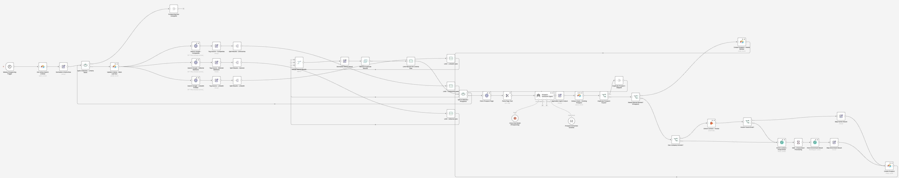

# Lead Gen Prospecting

I made an automation that searches Google for prospects every week, finds their contact details, and saves them to a CRM.

**For:** Building a list of people to sell to.

**Watch it run:** open the Lead Gen Prospecting card in the Gallery on [my portfolio](https://akshita9696.github.io/#gallery). It plays an example run on top of these real workflows.

**Built with:** n8n, SerpApi Google search, Groq, Hunter, Dropcontact and Airtable  
**Size:** 1 workflow, 43 steps

## How it works

1. **Every week, it reads the search criteria.** It reads each active search from Airtable and marks when it last ran.
2. **Searches Google three ways.** Three search lanes run side by side: company directories, editorial mentions and LinkedIn profiles. Each lane is capped, then the results are merged.
3. **Cleans the list.** Results are tidied, duplicates removed and each search capped.
4. **AI pulls out the prospect.** Each page is fetched and Groq extracts the person and the company. Known prospects are skipped and unclear ones are saved for review.
5. **Finds the email and saves it.** Hunter looks for the email from the company domain, with Dropcontact as the fallback. The prospect is saved to the CRM in Airtable.

## Workflows in this folder

| File | Workflow | Steps |
| --- | --- | --- |
| [`lead-gen-prospecting.json`](lead-gen-prospecting.json) | Lead Gen Prospecting | 43 |

## Use it yourself

In n8n, choose **Import from File** and pick a `.json` file. Then attach your own accounts (Gmail, Airtable, Gemini and so on) and replace the placeholders: `you@example.com`, Airtable IDs like `appXXXXXXXXXXXXXX`, and any `YOUR_...` values. No passwords or API keys are included.
